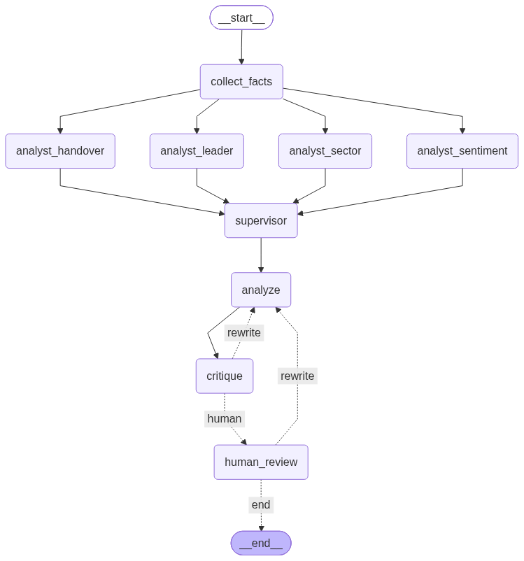

# stock-multiagent —— A股短线复盘多 Agent

> 用 **LangChain / LangGraph** 搭一个多 Agent 协作的短线复盘系统，
> 目标不是"能聊天的机器人"，而是**一个能被检查、被评估、能自己承认局限的分析流水线**。
>
> ⚠️ **本项目的所有产物仅为历史数据描述，不构成任何投资建议。**

---

## 一、为什么要做这个

已有 [`my-first-agent`](../my-first-agent/) 那个单 Agent 之后，这个项目要回答更进一步的问题：

| 单 Agent（my-first-agent） | 多 Agent（本项目） |
|---|---|
| 一个全能 Agent + 4 个工具 | 多个专职分析师 + 调度 |
| `create_agent()` 一行，循环藏在框架里 | **显式 `StateGraph`，架构能画出来** |
| 模块级 `conversation` 列表 | 显式 State schema + reducer |
| "我试了几个例子感觉还行" | **对 ground truth 算准确率** |

**核心设计理念：领域规则固化在工具层，不指望 LLM 记住。**

---

## 二、数据源与边界（重要）

**纯离线。运行期零网络。**

数据来自 [`../tradingagents-demo/local-analysis/out/`](../tradingagents-demo/local-analysis/out/)（只读引用，不复制）：

| 文件 | 内容 |
|---|---|
| `review_20261012_pools.json` | 10/12 涨停池(46) / 炸板池(25) / 跌停池 / 强势股池 |
| `review_20261012_snapshot.json` | 10/12 全市场快照（5572 只） |
| `review_20261012_kline.json` | 10/12 高标股日线（47 只，不复权） |
| `calendar.json` | 交易日历（原始 88 天，止于 2026-10-09） |
| `industry_map.json` | 代码 → 行业（5519 条） |
| `zt-review-20261012.md` | **已人工核验的短线复盘报告 → 本项目的 ground truth** |

**为什么纯离线**：东财接口并发 16 会被封 IP（本工作区踩过两次）；
项目 MongoDB 行情停更在 2026-05-29；Tushare Token 零接口权限。
不稳定的联网取数已前置为一次性离线快照 —— **数据采集与推理解耦**。

**当前只支持复盘日 `2026-10-12`**。离线快照是固定的，
`_assert_supported()` 会对其他日期**直接报错**，而不是静默返回别日期的数据。

---

## 三、进度

| 阶段 | 内容 | 状态 |
|---|---|---|
| 0 | 建目录 + git init | ✅ |
| **1** | **工具层 `tools.py`（无 LLM，领域规则固化）** | ✅ **43 项断言全通过** |
| **2** | **单分析师显式 `StateGraph`（`graph.py` + `prompts.py`）** | ✅ **已实跑并通过核查** |
| **4** | **反方审查员 + reflection 回路**（原计划第 4，**提前做**） | ✅ **12 项断言通过，回路实测触发** |
| **3** | **4 分析师 + Supervisor（并行扇出 + 事实包切片 + reducer）** | ✅ **18 项断言通过，并行已实测** |
| **5** | **`interrupt` 人工确认关 + 成本统计（按角色 + 缓存命中）** | ✅ **17 项断言通过（零成本测试）** |
| **6** | **`evaluate.py` 对 ground truth 算准确率** | ✅ **完成，并查出基准自身一个 bug** |
| **7** | **架构图渲染 + 成果展示文档（`render.py` / `demo.py`）** | ✅ **完成** |

> 📌 **想直接看成果** → 打开 [`out/DEMO.md`](out/DEMO.md)：一份自解释的展示文档，
> 含架构图 / 执行轨迹 / 4 视角结论 + 主管汇总 / 审查与人工确认 / 成本 /
> 评估准确率 / 局限 / 复现命令。
>
> 架构图：

### 阶段 7：把整个系统"拿给人看"

| 脚本 | 产出 | 关键设计 |
|---|---|---|
| `render.py` | `out/architecture.png` + `out/architecture.html` | **三级降级**：自包含 HTML（零依赖，一定能生成）→ PNG（走 mermaid.ink，需联网）→ SVG（需本机 `mmdc`） |
| `demo.py` | `out/DEMO.md` | **所有数字都从真实产物读取，一个都不硬编码** |

**为什么不直接用 `draw_mermaid_png()` 就完事**：它把图交给第三方服务
mermaid.ink 渲染，需要联网 —— **演示时最不能依赖的就是网络**。
所以主输出是自包含 HTML，PNG 只是可选加分项。

**`demo.py` 的原则是「不硬编码」**：它从
`out/facts-<date>.json`（轨迹 / 用量 / 审查 / 视角 / 人工审批）、
`out/eval-*.json`（准确率）、`out/review-<date>.md`（报告）里读数据。

> 好处：**文档永远不会和实际运行结果脱节** —— 重跑一次再跑 `demo.py` 就刷新了。
> 这也是归档纪律：关键数字实测核对后再写，不凭记忆
> （本工作区曾把数据体积按记忆写成 10MB，实测 17MB）。

> **为什么把第 4 步提前**：我们手上有 ②③④ 三个**真实失败样本**，审查员的
> 检查清单可以照着它们写；而且"加 1 个节点 + 1 条条件边"比"重写状态 + 并行扇出"
> 风险小得多 —— 一次只改一个变量。

### 阶段 2 实跑结果（2026-10-12，已核查）

```
🧮 collect_facts   0.049s   11 次工具调用 / 0 次 LLM
💰 analyze        24.939s   prompt 17686 字符 → 报告 5618 字符
[用量] deepseek-chat  in=7429  out=3807  total=11236
产物 review-2026-10-12.md（190 行 / 11.6KB）
```

**核查方法**：把报告里 71 种数字逐个比对事实包，找出"事实包里没有的"。

| 核查项 | 结果 |
|---|---|
| 幻觉（凭空编造的数字） | ✅ **0 个** |
| 免责声明 | ✅ 有 |
| 买卖建议措辞 | ✅ 无 |
| 7 条局限如实转述 | ✅ 全部列出 |
| 八个小节齐全 | ✅ 全齐，且模型**自发**多写了一节「我不确定的地方」 |
| 定点核对（宽度/封单/行业/龙头三指标/2板明细/炸板股） | ✅ 精确一致 |

**7 个"找不到"的数字，查明后全部无罪：**

| 数量 | 性质 |
|---|---|
| 5 个（`15`、`8.6`、`21.6`、`43`、`71`） | **透明派生**：7.06/0.47=15、7.06/0.82=8.6、10.17/47.12=21.6%、100−57=43、46+25=71 —— 算术全部正确 |
| 2 个（`20`、`59`） | 从 `_checks` 原文引用（扫描脚本只扫了 `facts` 没扫 `checks`） |

**由此产生的提示词修正（方案 B → 已生效）：**

原规则是「禁止推算事实包里没有的数值」，但报告里最有说服力的句子恰恰是派生值
（"封单占流通是九阳的 **15 倍**"）。所以改为：

> ✅ **允许透明派生**（简单算术：倍数/占比/差值/求和），**但必须写出算式**
> 　 例如 `21.6%（=10.17/47.12）`
> ❌ 不允许把派生值当独立事实陈述而不给算式；不允许引入事实包之外的信息

保留了说服力，同时**每个派生值仍可被逐条复核**。

**同时把「我不确定的地方」从"自发行为"提升为必写小节（第九节）。**
模型第一版就自己写了这一节，而且列出了一条我没发现的问题：

> 跌停池接口 tc=19 与快照自算准跌停 40 家之间的差异来源，**数据不足以判断**

### 三轮迭代记录（真实发现问题 → 修复 → 复验）

| 轮次 | 提示词状态 | 结果 |
|---|---|---|
| **1** | 原版（"禁止推算事实包里没有的数值"） | 幻觉 0；但做了 5 处**未标注**的透明派生；八节齐全；免责声明**自发**出现在末尾 |
| **2** | 加「允许透明派生 + 强制算式」；新增第九节 | 17 处算式 ✅；但 **免责声明消失（红线回归）** + 3 处叙述层错误 |
| **3** | 免责声明提升为**结构要求**；加第 8 条自检 | ✅ 免责声明回归；✅ 三处叙述层错误**全部消除**；算式增至 25 处 |

**第 2 轮的 3 处叙述层错误（数字全对，错在表述）：**

| 类型 | 报告原文 | 真相 |
|---|---|---|
| **自相矛盾** | 「8 家里有 **5 家**是连板股」，括号里却列出 6 只，末尾自己写「实为 6 家」 | 正确是 **6 家** |
| **比较方向反** | 「东百 3.21 亿在首板中**仅次于**赛力斯 3.1 亿」 | 3.21 > 3.1，东百**更大** |
| **计数错** | 「这 **4** 个高度」 | 7/8/9 是 **3** 个高度 |

**🔴 红线回归的根因（最重要的教训）：**

我把「我不确定的地方」加成**第九节**，却**没把免责声明写进结构清单**。
硬性规则第 4 条虽然写着"必须包含免责声明"，但**输出结构只到第九节为止** ——
模型就规规矩矩地以第九节收尾，免责声明没了。

第 1 轮它**自发**加在末尾，我因此误判"这条规则够牢"。
**改一处、必须复验副作用** —— 这正是本项目坚持"一次只改一个变量"的原因。

**第 3 轮新增的派生指标（都是它自己想出来的，算式均正确）：**

- `单位封单强度 2.06 倍 = (57/39.1)/(43/60.9)` —— 连板股 vs 首板 的"每单位家数占比换来多少封单"
- `18.94 亿 = 29.11 − 10.17` —— TOP10 去掉第一名后的合计
- `7.7% = 431/5564`、`8.5% = 471/5564`、`17.4% = 8/46`

**由此得到的结论（阶段 4 的最强论据）：**

| 错误类型 | 是否已解决 | 靠什么 |
|---|---|---|
| 凭空编造数字 | ✅ 已解决 | 工具层固化结论，LLM 不接触原始行情数据 |
| 算术算错 | ✅ 已解决 | 强制标注算式，每个派生值可逐条复核 |
| **前后矛盾 / 计数错 / 比较方向反** | ⚠️ **靠提示词压下去了，但不可靠** | 需要**独立的反方审查员节点** |

第 3 轮虽然修好了，但那是**靠"再叮嘱模型仔细点"**。这类错误本质上需要一个
**独立视角的节点拿着成品挑毛病** —— 就是阶段 4 的 reflection 回路。
（本轮提供了一个真实的失败样本集，可以用来驱动 Critic 的设计，
而不是凭空猜"审查员该查什么"。）

### 阶段 6：对 ground truth 算准确率（`evaluate.py`）

**把"我觉得还行"变成"命中率 100%" —— 而且它查出了 ground truth 自己的 bug。**

#### 对比双方

| 侧 | 来源 | 性质 |
|---|---|---|
| **我方** | `tools.compute_daily_stats / detect_handovers / rank_high_fliers` | 从 3052 只 × 88 日不复权日线**独立复算** |
| **基准** | `tradingagents-demo/.../nodes.json` | 此前用 `analyze_nodes.py` 跑出、并写进领域卡的结论 |

两边用**同一份日线**，所以这不是"模型准不准"，而是
**"我的口径实现对不对"** —— 一个 **205k 股票日** 的口径回归测试。

> 为此给工具层加了 3 个**区间工具**（`compute_daily_stats` / `detect_handovers` /
> `rank_high_fliers`），它们与原有 8 个单日工具**共用同一套口径函数**
> （`is_limit_up` / `trading_calendar` / 停牌相邻性）。

#### 实测结果

```bash
python3 evaluate.py
```

| 指标 | 结果 |
|---|---|
| 逐日涨停家数 `count` | ✅ **100.0%**（67/67） |
| 冰点线 `cold_line` | ✅ 一致（41 vs 41） |
| 高标票集合命中 | ✅ **69/69 = 100%** |
| 逐日最高连板 `max_run` | ⚠️ 85.1%（57/67） |
| 逐日 ≥2 板家数 `ge2` | ⚠️ 85.1% |
| 逐日 ≥3 板家数 `ge3` | ⚠️ 89.6% |
| 换龙事件 召回 / 精确 | 79.3% / 76.7% |

#### ⭐ 最重要产出：偏差不是我们算错，是**基准**漏了连板段首日

`max_run` 我方**系统性高 1**。逐票定位后，3 处不一致**全是同一模式**：
我方 `run_start` 比基准早一个交易日、`run_end` 完全相同。

用原始日线逐笔核对那 3 天：

| 票 | 日期 | 前收 | 涨停价 | 收盘 | 判定 |
|---|---|---|---|---|---|
| 新华传媒 | 2026-09-21 | 5.31 | 5.84 | **5.84** | ✅ 确是涨停 |
| 海鸥住工 | 2026-08-24 | 3.59 | 3.95 | **3.95** | ✅ 确是涨停 |
| 恒尚节能 | 2026-07-01 | 12.94 | 14.23 | **14.23** | ✅ 确是涨停 |

**还有第三方仲裁**：10/12 涨停池的东财 `lbc` 显示新华传媒是 **10 板**。

| 来源 | 10/09 | 推算 10/12 | 与东财 lbc=10 |
|---|---|---|---|
| 我方 | 9 板 | **10** | ✅ 一致 |
| 基准 | 8 板 | 9 | ❌ 对不上 |

→ **基准（`analyze_nodes.py`）漏掉了每个连板段的第一天**，`max_run` 因此少算 1。

> **这就是评估的真正价值：它发现的是 ground truth 的 bug，而不是模型的 bug。**
> 一个"两边对不上就改自己"的做法，会在这里**把对的改成错的**。

#### 换龙的 12 个漏报 —— 归因

| 归因 | 数量 | 说明 |
|---|---|---|
| **并列选票差异** | **12** | 同一天，**基准选的那只票我方也识别为断板票**（代码相同、连板高度也相同），只是并列断板票里选了不同的一只当 `A`。两种选择都对 |
| ⚠️ 我方未识别该断板票 | **0** | ✅ |
| ⚠️ 同一只票高度不符 | **0** | ✅ |

同时**修掉了我方一个真实实现问题**：第一版把当天**所有**断板票塞进 `A` 列表，
而基准每天只记**单只**（最强的），导致键永远对不上、召回只有 **25.9%**。
改为同构后 → **79.3%**。（当天其他断板票不丢，放在 `broken_all` 里。）

> 这条也是经验：**评估里"对不上"的第一嫌疑人应该是"两边的数据结构不同构"，
> 而不是"我算错了"。** 先对齐结构，再谈准确率。

#### 🔴 归因逻辑的循环论证 —— 已修正

**第一版的 `classify()` 只比连板高度、不比票的身份**，等于**假设**了
"差异来自 tie-break 约定"，而不是**验证**它：

> 两条分支都只看「当天我方 A 中是否存在 `run==gt_run` 的票」，
> **不检查那只票是不是 `c` 本身**。若我方把 `c` 的 run 算错、导致 `c` 没当上 A，
> 只要当天另有一只票高度碰巧相同，就误报「并列选票差异」**放过真问题**。

**复现验证**：造一个「我方真的选错票」的场景（我方 `A=999999` vs 基准 `A=600000`），
第一版判定为「并列选票差异」—— **指控成立**。

**修法：按票的身份归因**，而不是只比高度：

| 判定 | 含义 |
|---|---|
| 基准选的票 `c` **在我方当天全部断板票里**，且高度相同 | 真·并列差异（我方识别到了，只是没选它当 A） |
| 同上但高度差 1 | 基准 off-by-one 连带 |
| 基准选的票 `c` **不在**我方断板票里 | ⚠️ **我方漏识别 → 必须人工核查** |
| 同一只票但高度差 ≠ 0/1 | ⚠️ 高度不符 → 必须人工核查 |

**修正后结果反而更干净**：12 个**全部**是"同一只票、我方也识别到了"，
**0 个需人工核查**。而修正前结论里的「10 个并列 + 2 个 off-by-one」
中那 2 个其实是**高度比对造成的误判** —— 按票的身份核对，它们也是纯 tie-break。

> ⚠️ **这个缺陷的危险性值得单独强调**：它恰好会**掩盖本评估想抓的那类错误** ——
> 自己算错，却被归因成"差异来自基准"。**一个让评估器显得比实际更可靠的 bug，
> 比一个让评估器显得更差的 bug 危险得多。**


### 阶段 5：`interrupt` 人工确认关 + 成本统计

图末端新增一道**人工确认关**：

```
… → critique ─┬─(不通过且 revision<2)→ analyze
              └─(通过或达上限)→ human_review ─┬─(approve)→ END
                                              └─(reject:<意见>)→ analyze
```

**为什么必须有这一关：「生成报告」和「发布报告」是两件事。**
自动生成再自动交付，在企业里不可接受 —— 这份产物会被人当决策依据。
所以加一道人审：人可 approve，也可 reject 并写下具体修改意见，
后者会让图**回到执笔人**按人的意见重写。

#### `interrupt()` 依赖三件事同时正确

| 条件 | 少了会怎样 |
|---|---|
| `compile(checkpointer=...)` | 状态无处保存，**根本无法恢复** |
| 恢复时用**同一个 `thread_id`** | 找不到那份状态，等于重跑 |
| 恢复用 `Command(resume=...)` | 节点内的 `interrupt()` 拿不到答复，**卡住** |

这三条任意一条错，表现都是"卡住"或"静默重跑"，**从日志里很难看出来** ——
所以 `test_interrupt.py` 用**全假节点**把控制流单独测一遍（17 项断言、**零 token**）。

#### 非交互环境：自动通过，但**绝不假装人工确认过**

脚本/CI 里没有人可问。这时自动通过，但必须明确打印：

```
⏸  人工确认关 —— 图已暂停（`interrupt()` 生效）
  待交付报告版本：v1
  上一轮自动审查：通过
  审查总评：……未发现阻断性问题……
  ⚠️ 非交互环境，没有终端可以问人 → **自动通过**。
     这次并没有真正的人工确认，产物里 `human_decision` 会记为 auto-approve。
```

产物里留一份**人工审批审计记录**（谁批的、批了什么、打回几次）：

```json
"human": { "decision": "approve", "rejects": 0, "notes": [], "auto_approved": true }
```

#### 🔴 实测发现的设计缺陷：人的打回被机器熔断无声忽略

第一版 `route_after_human()` 里我写了注释"人工打回不占用 `MAX_REVISIONS` 额度"，
**但代码却拿 `revision` 判熔断** —— 结果场景 2 实测到：
自动审查刚好用满 2 次额度后，人的 `reject` **被无声忽略**，流程直接收工。

**修法：人工打回用独立预算** `MAX_HUMAN_REWRITES`（默认 2）。
人和机器应该是两套预算 —— 否则"机器刚好用完额度"会让人失去话语权。

#### 成本统计完善

**① 按角色分组**（见下方成本表）—— 一眼看出钱花在哪。

**② prompt 缓存命中率**（实测 52.5%）：

```
[用量] 7 次 LLM 调用  in=34358  out=6782  total=41140
       prompt 缓存命中 18048 / 34358 输入 tokens（命中率 52.5%，命中部分通常大幅折扣）
```

DeepSeek 会自动缓存公共前缀 —— writer 与 critic 共享大段 system prompt，
所以实际计费远低于 34k input。**这也是"多 Agent 并不等于成本×4"的另一个原因。**

> `estimate_cost()` 仍按未折扣的 input 计算，属**保守上界**；
> 要精确计费需要按官方缓存定价分别算，代码刻意没硬编码单价。

### 阶段 3：4 分析师并行扇出 + Supervisor + 事实包切片

完整图（★ 为阶段 3 新增）：

```
                     ┌──────────────┐
      START ──► collect_facts       │  确定性取数（无 LLM）
                     └──────┬───────┘
           ┌────────────┬───┴────────┬────────────┐   ★ 并行扇出
           ▼            ▼            ▼            ▼
    ★ sentiment   ★ leader    ★ handover    ★ sector
           └────────────┴───┬────────┴────────────┘
                            ▼
                     ★ supervisor          找冲突 / 排优先级 / 指缺口
                            ▼
                       analyze              执笔：九节报告
                            ▼
                       critique ─┬─(不通过且 revision<2)→ analyze
                                 └─(通过或达上限)───────→ END
```

#### 事实包切片：两层，实测省 70%

| 层级 | 做法 | 例子 |
|---|---|---|
| **① 板块级** | 每个视角只拿相关的事实包板块 | 龙头质量分析师只看 `抱团度` + `龙头质量` |
| **② 字段级** | 板块里过细的字段也砍掉 | 情绪/板块视角**不要**梯队的 `明细`（每只票的封单/换手/炸板都是噪音） |

实测（真事实包 7,632 字符）：

| 视角 | 切片 | 字符 |
|---|---|---|
| 情绪分析师 | 5 片（已砍明细） | 1,482 |
| 龙头质量分析师 | 2 片 | 1,493 |
| 换龙接力分析师 | 2 片（**保留**明细，判断承接力必须看封单占流通） | 5,127 |
| 板块带动分析师 | 2 片（已砍明细） | 1,135 |
| **4 份合计** | | **9,237 = 1.21× 全量** |
| 对比：人手一份全量 | | 30,528 = 4.00× 全量 |

**→ 省 70%。** 换龙接力那 5,127 字符是刻意的：它就是要看每只票的封单占流通。

> 这一版之前只做了板块级切片，实测只省 43%（因为 `连板梯队` 被 3 个视角共用
> 且很大）。加了字段级裁剪后才达到 1.21×。
> **"切片"这件事，做到板块级只是及格，做到字段级才是真的省。**

#### 并行是真的并行（实测证据）

| 视角 | 耗时 |
|---|---|
| analyst:handover | 6.268s |
| analyst:leader | 6.236s |
| analyst:sector | 6.545s |
| analyst:sentiment | 4.723s |

四个几乎同时结束 —— **总耗时约 6.5s，不是串行的 23.7s**。
它们在 LangGraph 的**同一个超步**里执行，由框架并发调度。

#### reducer 在这里才真正不可省

`findings` 带 `Annotated[..., operator.add]`。4 个分析师**并行**写同一字段：

- 有 reducer → **合并**（追加），4 份都在：`{'items': ['A','B']}`
- 没 reducer → **`InvalidUpdateError`**：`Can receive only one value per step`

> ⚠️ **这里我最初写错过，值得记一笔。** 我原先注释成"没 reducer 不会报错、
> 只会静默丢数据"，听起来更可怕 —— 但**实测是直接报错**：
>
> ```
> langgraph.errors.InvalidUpdateError: At key 'items':
>   Can receive only one value per step. Use an Annotated key to handle multiple values.
> ```
>
> 也就是说 reducer 解决的是「**并行写入怎么合并**」，而不是「防止数据消失」。
> LangGraph 在这件事上是 **fail loudly**，比静默丢数据好得多。
>
> 教训：**"框架在某个边界条件下会怎么表现"这种话，必须实测过才能写。**
> 我当时是凭"如果没写 reducer 会怎样"的直觉推的，方向错了 ——
> 把"更安全的报错"讲成了"更危险的静默失败"。

`test_reflection.py` 里专门有一条断言兜这个：
`4 份视角结论全部保留（reducer 生效，实收 4）` + `视角标签各不相同（无覆盖）`。

#### Supervisor 的价值（实测输出的真实发现）

它不只是"汇总"，它**跨视角找冲突**并发现了单个视角看不到的东西：

> **冲突点**
> - **情绪 vs 龙头**：情绪面 77.7% 下跌、471 家跌超 5%，但新华传媒 10 板封单 10.17 亿、
>   零炸板 —— 极端抱团与全面塌方并存，是"尖顶+塌方"结构。
> - **锁定 vs 连板**：**农心科技封单占比 15.51% 全场最高却仅 1 板**，
>   与新华"高度+锁定"双强形态矛盾。

第二条是**真实的数据洞察**，我们之前几轮都没注意到。

#### 一个刻意的取舍：重写只回到执笔人

审查意见针对的是**成稿**，4 份视角结论仍然有效，所以 `rewrite → analyze`（执笔），
**不重跑分析师** —— 既省 token 也省时间（实测：分析师只跑了 1 轮）。

**代价**：若审查发现某条**视角结论本身**错了，当前实现不会自动重跑该视角。
要修的话得让 critique 能定位到"是哪份视角的锅"并做条件边分派 —— 留作后续。

#### 坑 3：结构化输出偶发 `parsed=None`

实测遇到一次：调用**成功返回**，但 `parsed` 是 `None`（模型那一轮没返回 tool call），
于是审查降级、`ok=True` 静默放行 —— **最后一版报告其实没被审过**。

**修法：`_call_structured()` 两层兜底**
1. `method` 依次尝试 `function_calling` → `json_mode`（应对跨厂商不兼容）
2. **同一 method 内重试一次**（应对偶发 `parsed=None`）

离线单测验证了三条路径：调用抛异常 / 永远解析失败（尝试 4 次后降级）/ 首次失败重试成功。

**并且**：降级时在汇总里**显式告警**「最终一次审查降级了，最后一版未经实质审查」，
产物 `critique[].degraded` 也留着标记 —— 不让它静默通过。

> 顺带一个成本发现：`input_token_details: {'cache_read': 12411}` ——
> **DeepSeek 的 prompt 缓存生效了**，writer 与 critic 共享大段前缀，实际计费远低于 33k input。

### 阶段 4（提前做）：反方审查员 + reflection 回路

图从"一条直线"变成"带循环的分支"：

```
START → collect_facts → analyze → critique ─┬─(有问题 且 revision < 2) → analyze
                                             └─(通过 或 达上限) ────────→ END
```

**这几行就是 `create_agent()` 内部那个"循环"的本质 —— 条件边 + 回到前一个节点。**
做完这个，Agent 循环就不再是黑盒了。

#### 坑 1：结构化输出跨厂商不兼容 —— `json_schema` 被 DeepSeek 拒绝

```
with_structured_output(_Critique)                            # 默认 method=json_schema
  → 400 This response_format type is unavailable now
with_structured_output(_Critique, method="json_mode")        # 400 提示词需含 "json"
with_structured_output(_Critique, method="function_calling") # ✅ 可用
```

`langchain-openai` 的默认 `method` 是 `json_schema`（面向新版 OpenAI 模型），
DeepSeek 不支持。**修法：显式指定 `function_calling`，并保留下游降级兜底。**

> 通用教训：**框架的默认值往往假设你用的是 OpenAI 官方端点。**
> 换厂商时，默认值是最容易静默踩坑的地方。

#### 坑 2：审查员自己也会数错（误报）

"出示证据"铁律生效**前**的实测输出：

> 第2轮总评：竞价封板 8 家中连板股**实为 7 家**（报告写 6 家）

真相是 **6 家**（新华传媒/九阳/华北制药/新经典/丽人丽妆/德才股份）+ 2 首板 = 8。
它紧接着在自己的 detail 里**正确列出了全部 8 只**，却给了错误结论 ——
**并且要求分析师"改正"一个本来就正确的数字。**

**修法：把我们给分析师的纪律原样施加到审查员身上** —— 说出结论必须出示证据：

| 指控类型 | 必须出示 |
|---|---|
| 计数类（"实为 N 家"） | 逐个列出你数到的东西 |
| 比较类（"方向说反"） | 两个数值 + 比较结果 |
| 数字不一致 | 两处原文都引出来 |
| 漏免责声明 | 说明通篇查找过 |
| 证据不足 | **不要写这条 finding** —— 宁可漏报，不可误报 |

**修后同一个位置：**

> 第2轮 ok=True：报告数字与事实包一致（竞价封板 8 家=**6 连板+2 首板**、
> 东百 3.21>赛力斯 3.1、断档高度 7/8/9 共 **3 个**）

#### 🔴 由此得到的最重要结论：熔断不是可选项

上面那个误报如果没有熔断，会导致对**正确内容**的无限"修正"。
`MAX_REVISIONS = 2` 是这条回路能安全存在的前提。

而且**审查节点自身故障时会降级为 `ok=True` 并结束流程** ——
"审查能力不可用"绝不能变成"流程中断"或"无限重写"。
（离线单测已验证：注入一个必然抛异常的 LLM，路由结果为 `end`。）

#### 怎么验证回路（`test_reflection.py`）

**第一次实跑时审查员一次就放行了初稿 —— 也就是说 `rewrite` 这条边从未被执行过。
没走过的分支不算验证过。**

所以 `test_reflection.py` 把 `analyze` 换成假的（零 token）、`critique` 用真 LLM：

| 步骤 | 内容 |
|---|---|
| 第 1 版 | 故意植入 ②③④ + 漏免责声明 + 局限只列 2 条 |
| 第 2 版 | 修复稿；同时**记录它收到的 prompt**，用来证明审查意见确实被注入 |
| 12 项断言 | 判不通过 / 触发重写 / findings 非空 / 审查意见已注入 / 抓到各类缺陷 / 未降级 / **熔断生效** / 轮数未失控 |

```bash
python3 test_reflection.py     # 花 2 次 critic 调用的 token
```

实测：审查员抓到**全部 5 处植入缺陷**，另外还发现 1 处我们没植入的
（梯队表遗漏 3 板/2 板/1 板各档）。

### 阶段 2 设计说明

```
START → collect_facts → analyze → END
        （取数·无 LLM）  （LLM 分析师）
```

**这个文件存在的意义：把 `create_agent()` 藏起来的东西摊开。**

| | my-first-agent | 本项目阶段 2 |
|---|---|---|
| 建图 | `create_agent(model, tools, system_prompt)` 一行 | `StateGraph` + `add_node` + `add_edge` + `compile` 显式四步 |
| 状态 | 模块级 `conversation` 列表 + 隐式约定 | `TypedDict` 显式声明字段 |
| 多节点写同一字段 | 靠人记住谁先谁后 | **reducer**（`Annotated[..., operator.add]`）由框架保证 |
| 架构图 | 无 | `app.get_graph().draw_mermaid()` 一行拿到 |

**四个刻意的设计决策：**

1. **取数是确定性的，不让 LLM 选工具。** 复盘需要哪些数据是已知的固定集合；
   让 LLM 自己选会引入不确定性，还可能漏调关键工具导致报告缺项。
   → *确定性取数 + LLM 只做解释*。（对比 my-first-agent 的开放式问答：
   那时"用户会问什么"不可预知，工具选择**必须**交给 LLM —— 场景不同，选择不同。）

2. **reducer 用在哪、为什么。** `limitations` 和 `trace` 带 `operator.add`（追加），
   `facts` / `report` 不带（覆盖）。阶段 3 并行扇出时，reducer 是让 4 个分析师
   互不覆盖的关键 —— 这个字段级决策现在就先立好。

3. **龙头质量的对比对象不是"封单最大的几个"。**
   只挑最大的永远挑不到"烂板"，而「同样是 6 板，含金量差一个量级」
   恰恰是复盘里最有信息量的一句。所以选取规则刻意制造强弱对比：
   总龙头 + **同高度封单占流通最弱** + 次高板最弱两只。
   实测结果与原报告第四节那张表一一对应：

   | 个股 | 连板 | 封单 | 占流通 | 换手 | 炸板 | 判定 |
   |---|---|---|---|---|---|---|
   | 新华传媒 | 10板 | 10.17亿 | **7.06%** | 3.38% | 0次 | 强·筹码锁死 |
   | 九阳股份 | 6板 | 0.59亿 | **0.47%** | 16.07% | 5次 | 弱·散户抬轿 |
   | 时代万恒 | 6板 | 0.31亿 | **0.82%** | 32.01% | 3次 | 弱·散户抬轿 |

   （另外自动带出东百集团：**首板却有 3.21 亿封单、占流通 3.3%** —— 这是个值得看的信号。）

4. **失败处理：用 `stream_mode="values"` 而不是 `invoke()`。**
   实测踩过一次：`app.invoke()` 抛异常时，前面 `collect_facts` 辛苦取到的数据**全丢**，
   而且给用户甩了 50 行 traceback。改成流式后，每个节点跑完都给一份完整状态快照，
   于是「LLM 失败但取数成果保住」成为可能：

   ```
   ❌ 分析失败：AuthenticationError
      原因：API Key 无效，或还是 .env.example 里的占位符。
      处理：nano .env  → 把 DEEPSEEK_API_KEY= 右边换成你的真实 key
      ↳ 取数成果已保住，不重跑取数
   [产物]（部分）out/facts-2026-10-12.json  (23988 字节)
   ```

   这是「企业级 8 条」里的**失败处理**，成本很低但差别很大。

---

## 四、阶段 1 验证结果

```bash
python3 tools.py     # 退出码 0 = 全部匹配
```

把工具算出来的值，跟已人工核验的 `zt-review-20261012.md` **逐项比对**：

| 类别 | 核对项 | 结果 |
|---|---|---|
| 连板梯队 | 最高 10 板、1/2/1/14/28 分档、连板 18 家、断档 [9,8,7,5,4] | ✅ 全对 |
| 抱团度 | 封单合计 47.12 亿、TOP10 占比 61.8%、连板股封单占比 57% | ✅ 全对 |
| 竞价封板 | 9:25 封板 8 家 | ✅ |
| 炸板率 | 涨停 46 / 炸板 25 / 炸板率 35.2% | ✅ |
| 市场宽度 | 下跌占比 77.7%、准跌停 40 只 | ✅ |
| 龙头质量 | 新华传媒(10板/10.17亿/7.06%/3.38%/0炸板)、九阳、时代万恒 | ✅ 全对 |

**工具层能精确复现已核验的结论** —— 这是后续所有 Agent 工作的地基。

---

## 五、两个口径发现（阶段 1 的真实收获）

### 1. 「跌 5% 以上」是个歧义词，两种读法差 40 只

| 口径 | 家数 |
|---|---|
| `p <= -5`（含准跌停） | **471** |
| `-9.8 < p <= -5`（未及准跌停） | **431** |
| `p <= -9.8`（准跌停） | 40 |

原报告写「准跌停 40 只，跌 5% 以上 431 只」，用的是**未及准跌停**口径（471 = 431 + 40）。

**对策**：`market_breadth()` **两个值都返回并显式命名**，从源头消除歧义，
而不是替使用者选一个。

### 2. 百分比取整会造成"假不匹配"

连板股占比：工具 `39.1%`（18/46 = 39.13%），原报告写 `39%`。
是取整差异，不是口径错误。**核对时必须先对齐精度再比对。**

### 3. 交易日历缺了一天

`calendar.json` 只到 **2026-10-09**，不含复盘日 10/12。
不补这一天，「停牌跨日 → 连板归零」的校验在区间边界就会误判
（对应 `股票分析-交接与问题归档.md` 坑 8）。
→ `EXTRA_SESSIONS` 本地补齐，并在返回值里说明。

### 4. `.gitignore` 的 `.env.*` 会把 `.env.example` 一起排除

写了 `.env.*` 之后，`git status` 里 **`.env.example` 直接消失** ——
而它必须入库（只放占位符，是新人的配置模板）。修法是加一条否定：

```gitignore
.env
.env.*
!.env.example      # ← 必须显式放行
```

**顺带一个反直觉的坑**：`git check-ignore` 的退出码**不能**用来判断"是否被忽略"。
当最后匹配到的是否定模式（`!`）时，它**仍然返回 exit 0**，只把该模式打印出来。
所以下面这个判断是错的：

```bash
git check-ignore -q .env.example && echo "被忽略了"   # ❌ 误报
```

**正确判断方式**用这两个之一：

```bash
git add -n .env.example        # 能 add 就是没被忽略
git status --porcelain --ignored | grep '\.env'
```

---

## 六、工具层设计

`tools.py` 里 8 个工具，每个都返回统一格式：

```json
{
  "data": { "...结论..." },
  "_checks": { "我做了什么校验": "..." },
  "limitations": ["我知道自己哪里不可靠"]
}
```

| 工具 | 干什么 | 内置领域规则（出处见代码注释） |
|---|---|---|
| `data_boundaries` | 我到底能看到什么 | 数据时点、覆盖范围、已知缺口 |
| `ladder` | 连板梯队 | 交易日历相邻性（停牌防护） |
| `seal_strength` | 封单资金结构 | 封单/流通市值口径 |
| `leader_quality` | 龙头质量三指标 | 强/弱判定规则 |
| `auction_sealed` | 竞价即封板 | `fbt` 落在 09:25:00~09:25:59 |
| `blow_up_rate` | 炸板率 | 炸板数/(涨停+炸板) |
| `market_breadth` | 宽度 + 跌停兜底 | 跌停池空返回 → 快照自算 |
| `industry_breakdown` | 行业分布 | 显式标注"行业≠题材" |

**关键：LLM 只读工具结论，不碰原始数据。** 它就算想幻觉也没有原材料。

---

## 七、已知局限（每个结论都会带出来）

1. **只覆盖沪深主板非 ST** → 漏掉创业板/科创板 20% 涨停。
   10/12 主板最高标 10 板，但同日创业板/科创板有 **8 只 20% 涨停**，**真实情绪高度被低估**。
2. **带动效应按行业（东财 `hybk`）不是概念题材** —— 颗粒度偏细，会低估题材集中度。
   原报告的"传媒 14 家"是人工把 出版/影视院线/电视广播/数字媒体 聚合出来的。
3. **换龙只认当天接力**，真实资金接力常在断板后 1~2 天。
4. **未剔除新股上市首日（C 开头）与退市整理期**。
5. **跌停判定用统一 -9.8% 阈值**，未按各板块限制比例分档精确计算。
6. **数据止于 2026-10-12 收盘**，无实时能力。

---

## 八、运行

```bash
# 1) 工具层自检 —— 无需 API key、无需联网，零成本
python3 tools.py

# 2) 口径评估 —— 对 ground truth 算准确率（零 token，纯本地复算）
python3 evaluate.py

# 3) 人工确认关控制流测试 —— 全假节点，零 token
python3 test_interrupt.py

# 4) 回路专项测试 —— 故意植入缺陷，验证真的会打回重写
#    只花 2 次 critic 调用的 token（分析师/主管/执笔都是假的）
python3 test_reflection.py

# 5) 完整流程（取数 → 4 分析师 → 主管 → 执笔 → 审查 → 人工确认）
python3 graph.py                        # 默认复盘日 2026-10-12
MAX_REVISIONS=1 python3 graph.py        # 收紧自动重写熔断
HUMAN_REVIEW=0 python3 graph.py         # 关闭人工确认关
MAX_HUMAN_REWRITES=0 python3 graph.py   # 人工打回不给额度（试一次就收工）
```

**环境变量**：

| 变量 | 默认 | 作用 |
|---|---|---|
| `MAX_REVISIONS` | `2` | 最多生成几版报告（自动审查回路的熔断） |
| `HUMAN_REVIEW` | `1` | 是否启用人工确认关；非交互环境会自动通过并告警 |
| `MAX_HUMAN_REWRITES` | `2` | 人工打回的**独立**预算，与 `MAX_REVISIONS` 互不影响 |
| `DEEPSEEK_MODEL` | `deepseek-chat` | 模型名 |
| `ANALYST_TEMPERATURE` | `0.2` | 温度 |
| `DEEPSEEK_PRICE_*_PER_M` | 未设 | 填了才估算费用（刻意不硬编码单价） |

**依赖**：

| 阶段 | 依赖 |
|---|---|
| 1（工具层） | 仅 Python 标准库 |
| 2 起 | `langgraph` / `langchain-openai` / `python-dotenv` |
| 4 起 | `pydantic`（结构化输出；已是 langchain 的传递依赖） |

见 `requirements.txt`。

**实测用量参考**（deepseek-chat，2026-10-12）：

| 场景 | LLM 调用 | tokens | 耗时 |
|---|---|---|---|
| 单分析师（阶段 2） | 1 | ~11.9k | ~21s |
| 分析师 + 审查员（阶段 4，一次通过） | 2 | ~23.4k | ~23s |
| 单分析师 + 打回重写一次 | 4 | ~47k | ~45s |
| **多 Agent 全流程（阶段 3，一次通过）** | **7** | **~39.4k** | **~29s** |
| 多 Agent 全流程（阶段 5，含人工确认关） | 7 | ~41.1k | ~36s |
| 多 Agent + 打回重写一次 | 9 | ~69.3k | ~60s |

**成本结构**（阶段 5 实测，一次通过）：

| 角色 | 调用 | total tokens |
|---|---|---|
| 4 个视角分析师合计 | 4 | 11,534 |
| supervisor | 1 | 2,517 |
| writer | 1 | 14,223 |
| critic | 1 | 12,866 |
| human_review | 0 | 0（不调 LLM） |
| **合计** | **7** | **41,140**（其中 18,048 input 命中 prompt 缓存） |

注意：**4 个分析师加起来（11.5k）比 writer 一个人（14.2k）还便宜** —— 这正是切片的价值。
换句话说，多 Agent **不是**"成本 ×4"，主要开销仍然在执笔和审查这两步。

---

## 九、免责

**本项目所有分析仅为历史数据描述，不构成任何投资建议。**
