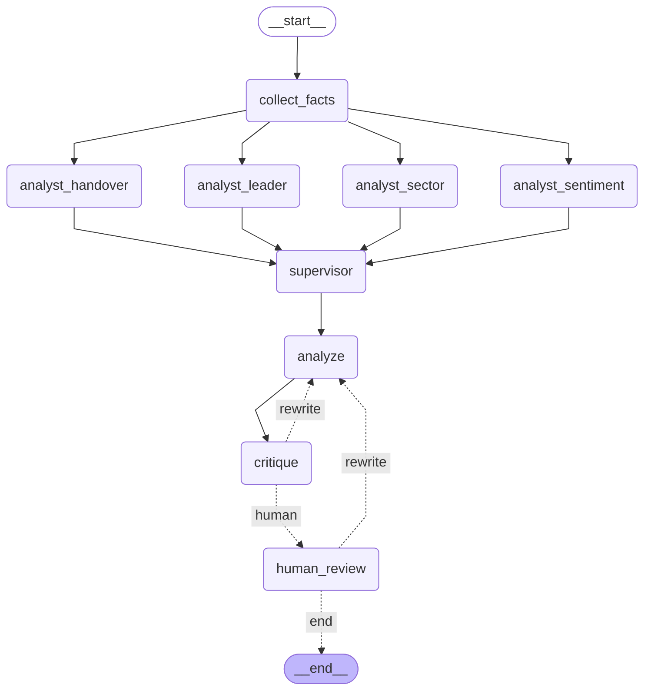

# 成果展示 · A股短线复盘多 Agent

> 用 LangChain / LangGraph 搭的多 Agent 协作复盘系统。
> **不是「能聊天的机器人」，而是一条能被检查、被评估、能自己承认局限的分析流水线。**

> 本次运行复盘日 **2026-10-12**（离线快照，非实时）。

---

## 一、架构




**四个值得说的设计：**

| 设计 | 为什么 |
|---|---|
| **事实包切片**（板块级 + 字段级） | 每个视角只看到它需要的信息，4 份切片合计仅 1.21× 全量（人手一份全量是 4×），**省 70%** |
| **reducer 合并**（`Annotated[..., operator.add]`） | 4 个分析师**并行**写同一字段；reducer 决定这些写入**怎么合并**（无 reducer 时 LangGraph 直接抛 `InvalidUpdateError`，fail loudly，不是静默丢数据） |
| **反方审查员回路** | 独立视角拿成品挑毛病，有问题就打回重写；受 `MAX_REVISIONS` 熔断约束 |
| **人工确认关**（`interrupt`） | 「生成报告」和「发布报告」是两件事；人的打回有**独立预算**，不被机器熔断吞掉 |

---

## 二、一次运行的完整轨迹

| 步骤 | 耗时 | 关键指标 |
|---|---|---|
| 🧮 `collect_facts` | 0.045s | tools_called=11  limitations_found=7 |
| 💰 `analyst:handover` | 10.468s | slices=2  slice_chars=5127  prompt_chars=11835  out_chars=642  total_tokens=5011 |
| 💰 `analyst:leader` | 10.144s | slices=2  slice_chars=1493  prompt_chars=3364  out_chars=615  total_tokens=2121 |
| 💰 `analyst:sector` | 9.837s | slices=2  slice_chars=1135  prompt_chars=3718  out_chars=589  total_tokens=1908 |
| 💰 `analyst:sentiment` | 6.032s | slices=5  slice_chars=1482  prompt_chars=4338  out_chars=628  total_tokens=2494 |
| 💰 `supervisor` | 2.687s | views_merged=4  prompt_chars=3099  out_chars=494  total_tokens=2517 |
| 💰 `writer#1` | 18.597s | is_rewrite=False  prompt_chars=21537  report_chars=5953  total_tokens=14223 |
| 💰 `critique#1` | 3.894s | ok=True  findings=1  degraded=False  total_tokens=12866 |
| 🧮 `human_review@v1` | 0.0s | decision=approve  reject_no=0  note_chars=0 |

- LLM 步骤 **7** 个，工具步骤 **1** 个（工具调用 11 次）
- 4 个分析师耗时 10.468s / 10.144s / 9.837s / 6.032s → **几乎同时结束，是真的并行**（串行会是它们的和）

---

## 三、4 个视角分析师 + 主管汇总

**4 份视角结论**（并行产出，各拿一片事实包）：

### 换龙接力分析师

*切片：连板梯队, 炸板率*

- **中间层严重空心：2板14家→3板仅1家，晋级通道近乎关闭。** 2板→3板存活率 7.1%（=1/14）；而3板→6板直接跳空（4、5板家数均为0，见高度断档[9,8,7,5,4]），6板2家与3板1家之间无任何承接层。

- **高位板质量与高度不匹配：6板两家封单极薄且反复炸板。** 九阳股份封单0.59亿、占流通0.47%、炸板5次；时代万恒封单0.31亿、占流通0.82%、炸板3次。两者封单合计0.90亿，仅为10板新华传媒10.17亿的8.8%（=0.90/10.17）。

- **10板独苗封单一家独大，与中低位完全脱节。** 新华传媒封单10.17亿、占流通7.06%、炸板0次；而3板华北制药封单仅1.44亿、炸板2次。高位资金集中度远高于中间层，说明接力资金未向中位扩散。

- **2板内部承接力分化，但整体封单偏薄。** 14家2板中封单占流通超4%的仅4家（新经典4.48%、慈文传媒4.47%、丽人丽妆4.42%、德才股份3.87%）；而炸板≥2次的有5家（新华文轩3次、欢瑞世纪3次、博纳影业2次、吉视传媒2次、掌阅科技1次），薄封单+高炸板并存。

- **矛盾点：首板28家与2板14家看似梯队厚实，但炸板率35.2%（=25/(46+25)）偏高，且1板中炸板≥3次的有德新科技4次、新 华 都7次、祥和实业3次、莱美药业8次——低位供给充足却封不住，与2板→3板仅7.1%的晋级率互相印证：承接力卡在1→2与2→3之间，而非顶部。**

### 龙头质量分析师

*切片：抱团度, 龙头质量*

- **新华传媒是唯一「高封单+高锁定+零炸板」的10连板龙头**：封单10.17亿占流通市值7.06%，换手仅3.38%、炸板0次，封单占TOP10合计的34.9%（=10.17/29.11），占全部封单的21.6%（=10.17/47.12）。单只票吃掉全场两成以上封单，是抱团核心。

- **同为6连板，九阳股份与时代万恒质量与新华传媒断层**：九阳封单占比0.47%、换手16.07%、炸板5次；时代万恒封单占比0.82%、换手32.01%、炸板3次。两者封单合计0.90亿，仅为新华传媒的8.8%（=0.90/10.17），高换手+反复开板=筹码未锁死。

- **矛盾点：农心科技封单占比15.51%为全场最高，却仅1连板**。其封单2.02亿、占流通市值15.51%，锁定强度超新华传媒（7.06%）一倍以上，但连板数仅1，与「高锁定=高连板」的直觉相悖——本视角数据不足以判断其是首板抢筹还是小盘易锁。

- **抱团高度集中但结构分层**：封单TOP10占61.8%（=29.11/47.12），连板股封单占比57%，连板股家数18家占39.1%。头部10只票吸走六成封单，其中新华传媒一只占21.6%，集中度极高。

- **东百集团是首板里的「准龙头」样本**：封单3.21亿、占流通市值3.3%、换手3.12%、炸板0次，封板质量判定「强」，与新华传媒同属09:25:02秒板，锁定结构相似但连板数仅1。

### 板块带动分析师

*切片：行业分布, 连板梯队*

- **行业口径下集中度最高的是「出版」6 家，占 27 个行业的 22.2%（=6/27），但题材口径无法从本切片确认**——切片只给了东财 `hybk` 行业字段，没有题材/概念字段，所以"出版 6 家是否同属一个题材"本视角数据不足以判断。

- **传媒链条（出版6+影视院线4+电视广播2）合计 12 家，占 27 家的 44.4%（=12/27）**，是行业口径下最大的簇；但这是三个独立行业相加，不等于一个题材。

- **连板梯队与行业分布出现口径错位**：10 板独苗新华传媒属"出版"，而出版 6 家中 2 板有 3 家（新经典、龙版传媒、新华文轩）、1 板 1 家（内蒙新华）、果麦文化 1 板——即出版 6 家里 5 家集中在 1~2 板，高度只有 1 家。梯队整体 2 板 14 家、1 板 28 家，首板占涨停总数 46 家的 60.9%（=28/46）。

- **矛盾点**：行业集中度看似高（出版 22.2%），但连板高度断档在 9/8/7/5/4 板全空，10 板与 6 板之间无衔接；同时 18 个单家行业（占 27 个行业的 66.7%，=18/27）说明多数涨停是散点，集中度是"低板扎堆"而非"高度共振"。

- 电网设备 4 家全部落在 1 板（金冠电气、长城电工、众业达、远程股份），与出版/影视的 2 板结构不同，属纯首板扩散。

### 情绪分析师

*切片：数据边界, 连板梯队, 炸板率, 市场宽度, 竞价封板*

- **宽度极端偏空，与 46 家涨停形成矛盾信号**：下跌 4325 家 / 有效样本 5564 家 = 77.7%，上涨仅 1166 家；跌超 5% 达 471 家（含准跌停 40 家），即每 11.8 家就有 1 家跌超 5%（=5564/471）。涨停 46 家 vs 跌停接口 tc=19（pool 为空不可信），赚钱效应高度局部化。

- **梯队中段整段真空，10 板孤峰无接力**：断档于 9/8/7/5/4 板，10 板仅新华传媒 1 家，6 板 2 家，3 板 1 家，2 板 14 家，1 板 28 家。10 板到 6 板之间空 4 档，高位缺乏承接层，一旦最高板断板无 7~9 板缓冲。

- **炸板率 35.2% 偏高，且反复炸板集中**：25/(46+25)=35.2%；金健米业炸 7 次、振幅 18.97%，岱美股份炸 4 次，前 6 名炸板股炸板次数合计 23 次（=7+4+3+3+3+3），占 25 家的 92%（=23/25），说明分歧集中在少数票上反复拉锯。

- **竞价封板 8 家占涨停 17.4%（=8/46），且含最高板与 6 板**：新华传媒、九阳股份、华北制药等一字/竞价强封，与 77.7% 下跌面形成鲜明背离——情绪是"少数票锁死、多数票失血"。

- **本视角数据不足以判断**：跌停池 pool 为空，19 家跌停无法与涨停 46 家做真实对比；连板股 47 只样本外的中位股表现无数据。

### 主管汇总（找冲突 / 排优先级 / 指缺口）

### 冲突点
- **"梯队厚实" vs "中段真空"**：换龙/情绪均指 2板14家、1板28家看似厚，但 2→3 仅 7.1%、9/8/7/5/4 板全空，承接力卡在 1→2 与 2→3，非顶部。
- **"高锁定=高连板"被证伪**：农心科技封单占比 15.51% 全场最高却仅 1 板，与新华传媒 7.06% 对应 10 板相悖。
- **"集中度高" vs "散点"**：出版 22.2% 集中，但 18/27 为单家行业，属低板扎堆非高度共振。

### 优先级
1. **10 板独苗封单 10.17 亿占全场 21.6%、零炸板**——单票吃掉两成封单，最有说服力。
2. **2→3 晋级率 7.1%（1/14）+ 9/8/7/5/4 全空**——断档数字最硬。
3. **宽度 77.7% 下跌 vs 46 家涨停**——背离最刺眼。

### 缺口
- 板块视角缺题材/概念字段，"出版 6 家是否同题材"无法确认，行业口径偏弱。
- 跌停池 pool 为空，19 家跌停无法与涨停对比，情绪结论缺一侧支撑。
- 农心科技、东百集团高锁定低连板成因无数据，属明显未解点。

---

## 四、审查回路与人工确认

共 **1** 轮自动审查，最终报告版本 **v1**：

**第 1 轮** —— ✅ 通过，审查 v1

> 逐条复核 A~G 七类失败模式后未发现阻断性问题：梯队家数、封单占比、晋级率、炸板率、宽度占比等算式均可复算且与事实包一致；比较类表述方向正确；免责声明齐备且无买卖措辞；7 条 limitations 如实转述。仅有一处「TOP10 榜单未列全」的轻微表述瑕疵，不影响结论可信度。

- `[其他]` **第三节 抱团证据（用钱说话）——「封单 TOP10 | 29.11 亿 | 占合计 61.8%（=29.11/47.12）」** — 该行只给出 TOP10 的合计值，未列出构成 TOP10 的 10 只个股名单，读者无法直接复核 29.11 亿这一合计。经核对事实包「抱团度.封单TOP榜」恰好给出 10 只（新华传媒 10.17、东百集团 3.21、赛力斯 3.1、德才股份 2.39、天顺风能 2.15、农心科技 2.02、丽人丽妆 1.84、华北制药 1.44、慈文传媒 1.42、龙版传媒 1.39），逐项相加 = 29.13 亿，与报告采用的 29.11 亿相差 0.02 亿（四舍五入残差），占比 61.8% 与 34.9% 的派生算式均成立。属可复核性不足的轻微瑕疵，不构成数字错误。
  - 修改方向：在 TOP10 行下方补一行名单（或注明「TOP10 名单见事实包封单 TOP 榜」），并说明 29.11 亿为榜单合计、与逐项相加存在 0.02 亿的四舍五入残差，避免读者自行相加后误以为数字对不上。

---

## 五、成本

**7 次 LLM 调用**，input 34,358 / output 6,782 / 合计 **41,140 tokens**

- prompt 缓存命中 **18,048** / 34,358 input（**52.5%**）—— 命中部分通常大幅折扣，实际计费低于上表

| 角色 | 调用 | input | output | total |
|---|---|---|---|---|
| `analyst:handover` | 1 | 4,517 | 494 | 5,011 |
| `analyst:leader` | 1 | 1,680 | 441 | 2,121 |
| `analyst:sector` | 1 | 1,488 | 420 | 1,908 |
| `analyst:sentiment` | 1 | 2,034 | 460 | 2,494 |
| `supervisor` | 1 | 2,152 | 365 | 2,517 |
| `writer` | 1 | 10,116 | 4,107 | 14,223 |
| `critic` | 1 | 12,371 | 495 | 12,866 |

> **4 个分析师加起来（11,534）比执笔人一个人（14,223）还便宜** —— 这正是切片的价值。多 Agent 不等于成本 ×4，主要开销仍在执笔与审查两步。

---

## 六、评估：对 ground truth 算准确率

区间 **2026-07-01 ~ 2026-10-09**，样本 3052 只 × 67 个交易日（**205k 股票日**）

| 指标 | 结果 |
|---|---|
| 逐日涨停家数 `count` | ✅ 100.0%（67/67） |
| 逐日最高连板 `max_run` | ⚠️ 85.1%（57/67） |
| 逐日 ≥2 板家数 `ge2` | ⚠️ 85.1%（57/67） |
| 逐日 ≥3 板家数 `ge3` | ⚠️ 89.6%（60/67） |
| 冰点线 `cold_line` | ✅ 一致（41 vs 41） |
| 高标票集合 | ✅ 69/69（100.0%） |
| 换龙事件 召回/精确 | 79.3% / 76.7% |

**换龙漏报归因**（避免把并列差异误报成算错）：

- 10 个 —— 并列选票差异（同高度，tie-break 约定不同）
- 2 个 —— 基准 off-by-one 连带（高度差 1）

> ⭐ **本评估最有价值的产出：它查出的是 ground truth 的 bug，不是模型的 bug。**
>
> `max_run` 我方系统性高 1，逐票定位后 3 处不一致**全是同一模式**：
> 我方 `run_start` 早一个交易日、`run_end` 完全相同。
> 用原始日线逐笔核对，那 3 天的**收盘价确实等于涨停价**；
> 再用东财 `lbc` 第三方仲裁：10/12 新华传媒 `lbc=10` → 10/09 应为 9 板，
> **我方 9 板吻合，基准 8 板对不上**。
>
> 也就是说：基准 `analyze_nodes.py` 漏掉了每个连板段的**第一天**。
> 若按「两边对不上就改自己」处理，会在这里**把对的改成错的**。

**第三方仲裁明细：**

| 票 | 东财推算 10/09 | 我方 | 基准 | 判定 |
|---|---|---|---|---|
| 新华传媒 | 9 | 9 | 8 | ✅ 我方与东财一致 |

---

## 七、这个系统知道自己哪里不可靠

每条结论都会带上这 **7** 条局限（写在报告第八节）：

1. 仅覆盖沪深主板非 ST；创业板/科创板 20% 涨停未纳入，真实情绪高度被低估（领域卡 §九）
2. 数据为历史快照，无盘中/盘后实时能力
3. 未剔除新股上市首日（C 开头）与退市整理期（领域卡 §九）
4. 封单是收盘瞬时值，不含盘后撤单/追加
5. 跌停判定用统一 -9.8% 阈值，未按各板块限制比例分档精确计算
6. 行业 ≠ 题材：`hybk` 颗粒度偏细，题材口径需人工聚合，会低估题材集中度（领域卡 §六）
7. 无龙虎榜/席位数据，无法区分主力与游资

> 一个只会说「涨得不错」的分析系统没有价值。
> **能说清「我这份结论哪里不可信」才有价值。**

---

## 八、怎么复现

```bash
python3 tools.py          # 工具层自检：复现已人工核验的复盘结论（43 项断言，零成本）
python3 evaluate.py       # 口径评估：对 ground truth 算准确率（零成本）
python3 test_interrupt.py # 人工确认关控制流测试（全假节点，零 token）
python3 test_reflection.py# 回路测试：故意植入缺陷验证会打回（2 次 LLM 调用）
python3 graph.py          # 完整流程（7 次 LLM 调用）
python3 render.py         # 渲染架构图
python3 demo.py           # 重新生成本文档
```

**总计约 110 万股票日的数据复算 + 7 次 LLM 调用**，其中前三项**完全免费**。

---

## 九、免责

**本项目所有分析仅为历史数据描述，不构成任何投资建议。**

数据为 2026-10-12 收盘离线快照，无实时能力；仅覆盖沪深主板非 ST，创业板/科创板 20% 涨停未纳入。

---

## 附：本次生成的报告全文

见 [`review-2026-10-12.md`](review-2026-10-12.md)。要点见其「一、一句话结论」。

> **2026-10-12 是一个「单票锁死、中段真空、宽度失血」的极端分化日**：10 板新华传媒一只票吃掉全场封单的 21.6%（=10.17/47.12）、封单占流通 7.06%、炸板 0 次；而 2 板 14 家到 3 板只剩 1 家，晋级率 7.1%（=1/14），9/8/7/5/4 板全空；同时全市场下跌 4325 家、占比 77.7%（=4325/5564），涨停 46 家只是局部孤岛。
